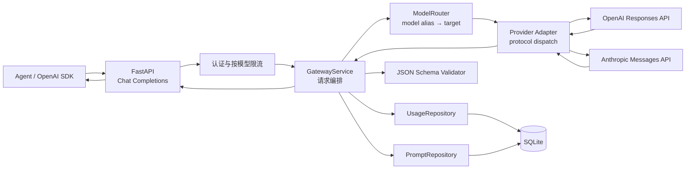

# 双协议 LLM Gateway 设计

## 目标与约束

对调用方只暴露一个 OpenAI Chat Completions 接口；根据 `model` 别名，将请求发往使用 OpenAI Responses API 或 Anthropic Messages API 的上游。Gateway 隔离协议、认证、请求字段和响应格式差异，并为每次调用提供一致的流式行为、结构化校验、Prompt 引用和观测数据。

## 模块与职责

### API 与输入模型

`app/api/routes.py` 暴露单一统一推理入口 `POST /v1/chat/completions`。它做 HTTP 参数校验、调用方认证/限流依赖、调用 GatewayService，并根据 `stream` 返回 JSON 或 SSE。管理路由负责 Prompt、模型、路由状态和用量查询。

`app/schemas.py` 定义公开 Chat Completions 请求、Prompt 管理和返回模型。供应商协议字段不暴露给客户端。

### 访问治理

`app/core/security.py` 验证 Gateway API Key，将其变成不可逆调用身份指纹。`app/core/rate_limit.py` 按 `(identity, public_model_alias)` 使用独立令牌桶；同一调用者对一个模型触发 429，不影响其调用另一个模型。

这版限流器是进程内状态。水平扩容后应迁移到共享存储；正式多租户部署也应将身份细化为租户 ID，并维护租户级模型权限/额度。

### GatewayService：请求生命周期编排

`app/services/gateway.py` 维护一次调用的 request ID、请求耗时、上游候选、重试、输出校验和 UsageEvent。它调用 PromptRepository、ModelRouter、UpstreamClient、结构化校验器和 UsageRepository，但不直接拼 HTTP 头或 SQL。

主要顺序：

1. 生成 request ID、记录开始时间与调用身份。
2. 解析并渲染 `gateway_prompt`。
3. 使用 `model` 别名和协议能力获取候选目标。
4. 调用 UpstreamClient；失败时按错误类别、次数上限和指数退避策略重试。
5. 本地验证结构化结果；必要时加入修复指令再调用。
6. 返回 JSON 或流式内容，并落用量和延迟。

### ModelRouter 与配置

`app/services/router.py` 将别名映射到按优先级排列的 `RouteTarget`，过滤禁用供应商、协议不匹配目标和熔断目标。路由声明 `protocol`：`openai_responses` 或 `anthropic_messages`；旧的 `openai_chat` 适配器保留用于本地 Mock 和兼容测试。

`app/config.py` 与 `gateway.example.yaml` 描述供应商 base URL/API Key、公开模型名、上游模型 ID、协议、重试、熔断、限流和估价。启动时校验配置引用。真实模型可用性、base URL 和协议支持必须以账号实际配置为准。

### Provider Adapter：协议边界

`app/services/adapters.py` 是适配器注册表，`get_adapter(protocol)` 按路由目标选择实现。

**OpenAI Responses adapter**

- 转换为 Responses API 请求。DeepSeek 官方 endpoint 为 `/responses`，由 provider 的 `endpoint_paths` 覆盖通用路径 `/v1/responses`。
- 将 Chat 的 system/developer 消息合并为 `instructions`，其余消息转成 Responses `input`。
- 将 token 上限与 `response_format` 映射为 Responses 字段。
- 从 `output_text` 或 `output` 提取文本，并转换成 OpenAI Chat Completion 响应。

**Anthropic Messages adapter**

- `POST /v1/messages`；DeepSeek Anthropic base URL 包含 `/anthropic`，最终路径是 `/anthropic/v1/messages`。
- 使用 `x-api-key` 和 `anthropic-version`，不使用 OpenAI Bearer 头。
- 将 system/developer 内容放入 `system`，user/assistant 转成 Messages `messages`，补充 `max_tokens`。
- 将文本 block、停止原因和 Anthropic usage 转成统一 Chat 响应与 Token 分类。
- 结构化 Schema 以明确指令传入，由本地 JSON Schema 校验提供最终约束。

### UpstreamClient：传输层

`app/services/upstream.py` 接收 adapter 生成的路径、请求头和 body，负责 HTTP 请求、超时、SSE 打开、连接关闭及错误转换。它不负责决定使用哪个供应商，也不定义别名策略。

### 流式归一化

`StreamNormalizer` 将不同协议 SSE 分帧：

- Responses: 读取 `response.output_text.delta`、`response.completed`。
- Anthropic: 读取 `content_block_delta`、`message_start`、`message_delta`、`message_stop`。
- 输出统一的 OpenAI Chat Completion SSE chunk。

TTFT 以第一个文本增量为准，不以响应头或首个任意字节作为准。客户端断开时关闭上游。第一段文本发出之前允许重试/切换；发出文本后失败，则返回错误 SSE 并结束，因为模型间无法安全续写。

### 结构化输出与 Prompt

`app/services/structured.py` 提取文本，解析 JSON 并运行 JSON Schema 验证。对非流式响应，失败后可把校验错误反馈给模型，重试次数受 `structured_output_retries` 限制；最终失败返回统一错误。

`app/services/prompts.py` 保存 Prompt 的不可覆盖版本、激活版本和创建时间，使用 Jinja Sandbox 与严格变量检查。客户端通过 `gateway_prompt` 引用模板 ID、版本和变量；调用账本只保留 Prompt 元信息，不保存用户正文。

### 用量和错误

`app/services/usage.py` 持久化请求和 Token 计量：

- 总输入 Token、未缓存输入 Token
- 缓存读取 Token、缓存创建 Token
- 输出 Token、推理 Token
- 成本估计、总延迟、TTFT、重试、fallback 和状态

Responses/OpenAI 用法统计从 `usage` 与 `*_tokens_details` 读取；Anthropic adapter 将 cache read/cache creation 纳入输入分类。无供应商 usage 时记录 0，而不自行猜测 tokenizer 数量。

`app/core/errors.py` 将内部异常转换成统一 OpenAI 风格对象。HTTP 错误保留可重试标记；错误正文不会把供应商密钥输出给调用方。

## 重试与限流语义

- `max_total_attempts` 是单请求上游总尝试上限，范围 1–3；默认 3。
- `max_attempts_per_route` 限制某个目标的重复尝试，也不能超过 3。
- 只对网络/超时和 `retry_statuses` 内的状态码重试。
- 退避为 `min(base × 2^attempt, max_delay)`，加入随机抖动；尝试总数包括 fallback 目标上的调用。
- 配置有多个目标时，未耗尽总尝试预算才继续下一个路由。
- 令牌桶 key 是调用身份和公开模型别名组合，各模型的配额互不串扰。

## 存储与部署边界

SQLite 适合单实例训练环境。限流和熔断当前是进程内状态；多副本部署需共享状态。流式检查点默认关闭，因为它会保存模型正文。成本是按配置价格估算，价格需人工维护。

## 验证策略

测试使用 HTTPX MockTransport，检查 provider URL、请求 JSON、鉴权头、响应归一化和 SSE 转换，不访问真实模型。`scripts/verify_gateway.py` 可重复运行全部测试。真实在线验收仍需配置供应商密钥、可用模型和准确的协议 endpoint。
